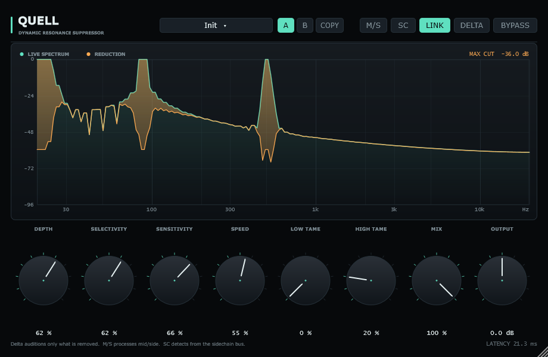
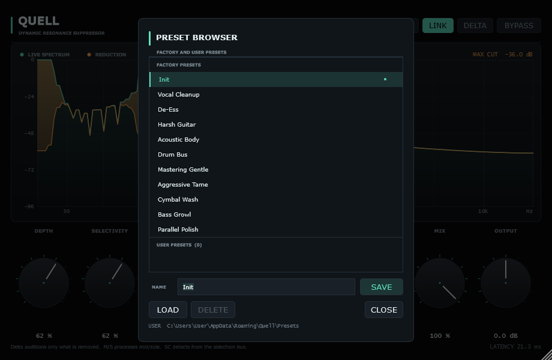

# Quell

A dynamic resonance suppressor for Windows and macOS (VST3 + Standalone), in the
spirit of oeksound's *soothe*. It listens to the short-time spectrum, estimates
the broad shape the material is *supposed* to have, and ducks only the narrow
peaks that stick out above it - so harsh vocal resonances, cymbal ring, acoustic
guitar body modes and metallic guitar fizz get smoothed without dulling the whole
source.

This is an original implementation built on JUCE: no impulse responses and no
data from any commercial product. The detection and gain laws are described
below so you can see exactly what it does.





## Signal path

```
main input (or the sidechain input, when SC is on)
  -> optional mid/side matrix
  -> STFT analysis (Hann analysis window, 75% overlap)
  -> per-bin magnitude in dB
  -> local spectral envelope (zero-phase, fractional-octave smoothing)
  -> excess = bin dB - envelope dB
  -> threshold by SENSITIVITY, scale by DEPTH and by LOW/HIGH TAME
  -> narrow smoothing of the cut curve, gain attack/release in time
  -> apply real gain to the complex spectrum (phase untouched)
  -> inverse FFT, Hann synthesis window, overlap-add
  -> dry/wet MIX (dry path delayed to match) or DELTA
  -> OUTPUT trim
```

The important consequence: the processor never touches a filter coefficient or
the phase response, so the correction stays minimum-phase and stable, and the
amount of reduction adapts from frame to frame rather than being a fixed EQ.

### Why it stays clean

* The envelope is a zero-phase, bandwidth-growing smoother, so it follows the
  broad spectrum at every octave instead of every individual FFT bin.
* The cut curve is smoothed across a few neighbouring bins before it is applied,
  which avoids single-bin holes and "spectral whistle".
* Gains are smoothed in **dB** with a short attack and a longer release, so the
  processing breathes with the music rather than with the FFT grid.
* The analysis/synthesis Hann pair at 75% overlap sums to exactly 1.5, so at
  depth 0 the output is sample-exact delayed input (asserted in the tests).
* `DELTA` is the exact dry-minus-wet residual: `wet + delta = dry`.

### Latency

One FFT frame, chosen by sample rate:

| Sample rate | FFT size | Latency |
| --- | --- | --- |
| 44.1 / 48 kHz | 1024 | 1024 samples (21.3 ms at 48 kHz) |
| 88.2 / 96 kHz | 2048 | 2048 samples (21.3 ms at 96 kHz) |

It is reported to the host, and the dry path is delayed to match, so parallel mix
and delta stay phase-aligned.

### Presets

The header preset button opens the browser. Select a row and press **LOAD**, or
double-click it. **SAVE** stores the current sound under the name in the field;
if a user preset with that name exists, press SAVE a second time to replace it.
**DELETE** removes the selected user preset after confirmation.

User presets are XML files in `%APPDATA%\Quell\Presets` on Windows and
`~/Library/Application Support/Quell/Presets` on macOS. They store every sound
parameter, including M/S and sidechain mode, but not BYPASS or DELTA, which are
monitoring states rather than part of a saved sound.

### Mid/side and external sidechain

With **M/S** enabled, the stereo signal is converted to mid `(L+R)/2` and side
`(L-R)/2` before analysis and converted back afterwards. This is useful when a
resonance sits in the centre (mid) or in the difference signal (side) and you
want the two treated independently rather than as left and right. Mono layouts
skip the matrix.

Quell declares a second, normally disabled, stereo input bus named
`Sidechain`. Enable **SC** and route a signal to that bus in your DAW: detection
then follows the sidechain spectrum while the main input is what gets filtered -
handy for ducking a resonance in a pad from a vocal, or for triggering
suppression from an unprocessed copy. A mono sidechain drives both detectors;
if the host has not activated a sidechain bus, SC falls back to internal
detection so the control is never silently destructive. Both modes keep the same reported latency.

## Controls

| Control | What it does |
| --- | --- |
| **Depth** | How much of the detected excess is removed. 0% is a true bypass. |
| **Selectivity** | How narrow the detection envelope is. Low focuses on broad humps; high hunts narrow rings. |
| **Sensitivity** | Threshold: how far a peak must rise above the local spectrum before it is touched. Lower leaves more intact. |
| **Speed** | Attack/release of the gain curve. Fast clamps transients; slow is more transparent. |
| **Low Tame** | Backs the processing off below roughly 700 Hz. |
| **High Tame** | Backs it off above roughly 5 kHz. |
| **Mix** | Parallel blend with the unprocessed, latency-compensated dry signal. |
| **Output** | +/-24 dB output trim. |
| **LINK** | Detect both channels together (default), preserving the stereo image. |
| **M/S** | Process mid and side instead of left and right. |
| **SC** | Use the sidechain input bus as the detector. Falls back to the main input when the host has not activated the bus. |
| **DELTA** | Hear only what is being removed. |
| **BYPASS** | Hard bypass, latency preserved. |
| **A / B / COPY** | Two comparison slots. COPY pushes the current settings to the other slot. |
| **PRESETS** | Opens the browser: factory starting points plus user presets, with save and delete. |

The large display shows the live input spectrum (mint) and the amount of reduction
at each frequency (amber, hanging beneath the spectrum), with the peak cut in dB.

## Building

The project reuses the JUCE 8.0.6 checkout that is vendored at the repository
root (`../JUCE`). On Windows, with Visual Studio 2022 and the bundled CMake:

```bat
Quell\build.bat
```

or manually:

```bat
tools\cmake\bin\cmake -S Quell -B Quell\build -G "Visual Studio 17 2022" -A x64
tools\cmake\bin\cmake --build Quell\build --config Release --parallel
```

Outputs:

```
Quell\build\Quell_artefacts\Release\VST3\Quell.vst3
Quell\build\Quell_artefacts\Release\Standalone\Quell.exe
```

Copy the `Quell.vst3` **folder** into `C:\Program Files\Common Files\VST3`
(all users, needs admin) or your DAW's user VST3 folder, then rescan.

### macOS

A Mach-O plugin cannot be produced on Windows. On macOS, build and package a
High Sierra-targeted x86_64 VST3 with:

```bash
cd Quell
chmod +x build-macos.sh
./build-macos.sh
```

The script uses the vendored `../JUCE` checkout, configures with
`CMAKE_OSX_DEPLOYMENT_TARGET=10.13`, builds only the VST3 target, verifies the
Mach-O architecture and minimum OS, and writes:

```text
Quell/dist/Quell-VST3-macOS10.13-x86_64.zip
```

The CMake project still defines AU and Standalone targets; use the CMake
commands directly if you need those formats. The GitHub Actions workflow
produces the same VST3 zip on an Intel macOS runner.

## Tests

Run the complete local workflow with:

```bat
Quell\test.bat
```

It builds the test targets, runs the DSP and host checks, runs the real-mix
regression when its local fixture is available, installs the freshly built VST3
into the per-user VST3 folder, and runs the REAPER preset round-trip. The DAW
step requires REAPER and Python; set `REAPER_EXE` if REAPER is not in the
standard installation directory.

**DSP maths** (JUCE-free):

```bat
Quell\build\Release\QuellDSPTest.exe
```

Checks FFT round-trip accuracy, bit-transparency at depth 0, exact latency,
selective suppression of a 3 kHz resonance above a noise bed, delta/wet
reconstruction, mid/side transparency and suppression, external-sidechain
detection and silent-sidechain fallback, bounded output at extreme settings,
and mono/stereo/linked processing.

**Host validation** (loads the built VST3 through JUCE's VST3 host, the same path
a DAW uses):

```bat
tools\cmake\bin\cmake --build Quell\build --config Release --target QuellHostTest
Quell\build\QuellHostTest_artefacts\Release\QuellHostTest.exe "Quell\build\Quell_artefacts\Release\VST3\Quell.vst3"
```

It verifies discovery, instantiation, all 13 parameters, the sidechain bus,
reported latency, audio flow, that depth changes the audio, delta monitoring,
mid/side and sidechain modes, user preset save/load/delete and persistence, the
editor, and state serialisation.

**Real-mix default regression** (uses the current plugin defaults; fails if they
remove more than 2 dB overall or 5 dB of 8–16 kHz energy):

```bat
Quell\build\QuellHostTest_artefacts\Release\QuellHostTest.exe --defaults-mix Quell\build\daw-real\dry.wav
```

The fixture is the dry 30-second excerpt from the DAW audition workflow. Pass a
path to another dry mix when needed; optional arguments override the two limits.

**DAW project round-trip** (requires REAPER):

```bat
python Quell\tools\daw\run_preset_reopen_test.py
```

It opens a media-free project with Quell and the "Vocal Cleanup" preset already
selected, saves it, reopens it, and verifies the parameters and the persisted
`presetName`. It exits non-zero on failure. Set `REAPER_EXE` if REAPER is not in
the standard installation directory.

The same binary can render the UI without a DAW:

```bat
Quell\build\QuellHostTest_artefacts\Release\QuellHostTest.exe --shot ui.png 920 600
Quell\build\QuellHostTest_artefacts\Release\QuellHostTest.exe --shot-browser presets.png 920 600
```

## Licence

The plugin source links JUCE, which is dual-licensed (GPLv3 or a commercial JUCE
licence). Building and distributing it means complying with one of those. The
Quell source itself is yours to use.
